# Pagination

> Before trying to understand Extended Page Tables, we need to understand pagination first.

Pagination is one of many ways of solving the problem of **process isolation in memory**.
The idea is to divide RAM into small chunks called **pages** (usually 4KB), and give each
process its own virtual address space — so two processes never step on each other's memory,
even if they use the same addresses.

---

## The idea

The CPU works with **virtual addresses** — the ones that programs see.
Physical RAM works with **physical addresses**.
Pagination is the mechanism that translates one into the other.

Without pagination, two processes using address `0x1000` would overwrite each other.
With pagination, every process has its own virtual address space, and those `0x1000`
addresses are actually two different spots in physical memory.
The CPU translates the `0x1000` of each process and the results are different physical addresses.

The one doing the translation is the **MMU (Memory Management Unit)**.
The "map" that helps the MMU translate virtual addresses to physical addresses is the **page table**.

A virtual address has two parts:
1. The **virtual page number (VPN)** — the index into the page table
2. The **offset** — where exactly inside that page the address lives

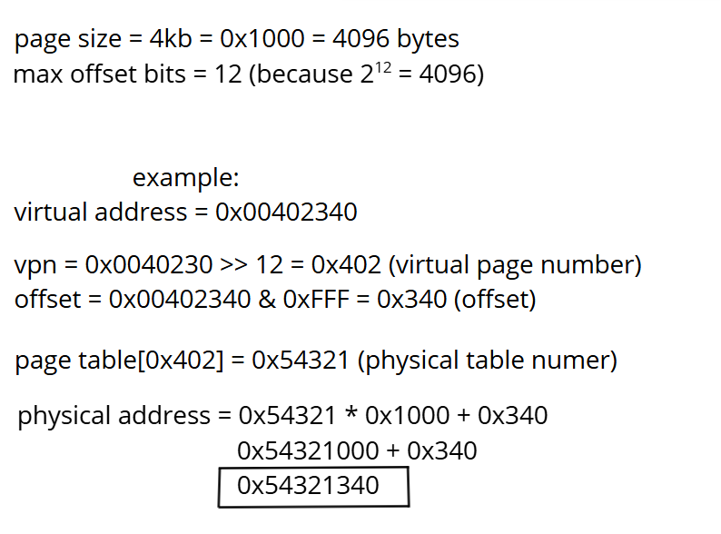

> **Pages** are 4KB blocks that belong to virtual memory.  
> **Frames** are 4KB blocks that belong to physical memory.

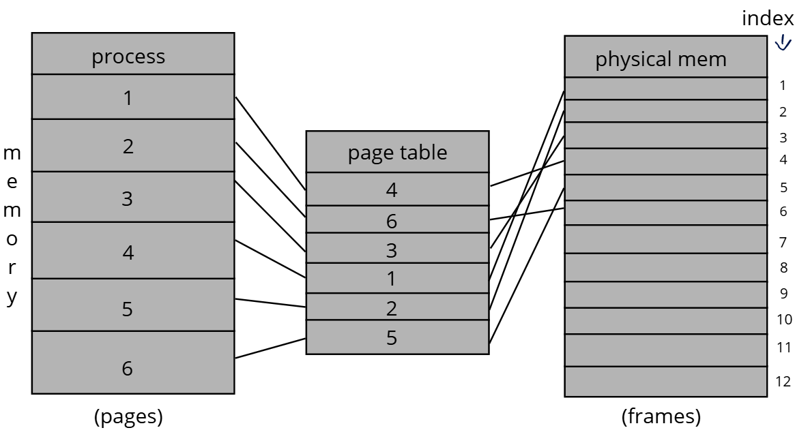

---

## How pagination works in x86-64

In x86-64, addresses are 64 bits wide, but only **48 bits are actually used**.
The upper 16 bits (48..63) are just a sign extension of bit 47 — they repeat its value.

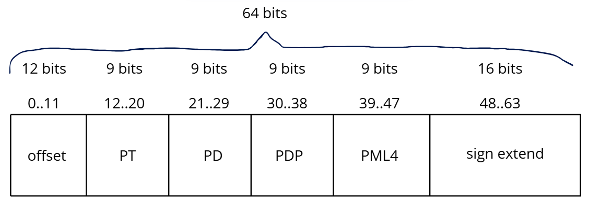

Instead of one flat table (which would require 512GB of memory just to store it),
x86-64 uses **four nested tables**. Each table has exactly 512 entries of 8 bytes each —
fitting perfectly in one 4KB page. With this structure, only the tables that are actually
needed get allocated — empty regions of virtual space cost nothing.

```
PML4  →  Page Map Level 4        ← CR3 points here
PDP   →  Page Directory Pointer  ← PML4 points here
PD    →  Page Directory          ← PDP points here
PT    →  Page Table              ← PD points here
                                 ← PT points to the actual physical frame
```

Every 9-bit index can address 512 values (2⁹ = 512), matching exactly the 512 entries
per table. This is not a coincidence — the sizes were chosen so everything fits perfectly.

---

## How a table entry looks

Every entry of every table (PML4, PDP, PD, PT) has the **exact same 8-byte format**:

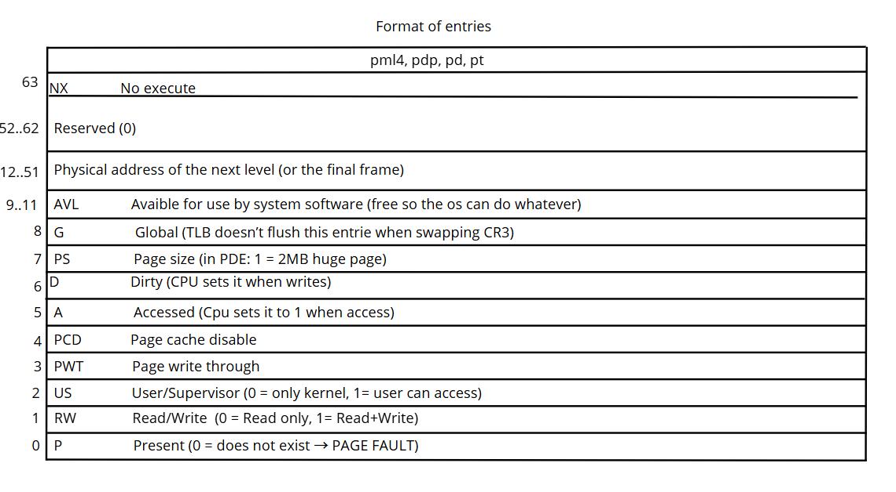

To get the address of the next table from an entry, mask out the lower 12 bits (flags):

```c
next_table_address = entry & 0x000FFFFFFFFFF000
```

---

## CR3 — the entry point

CR3 is a CPU register. Only one per core. It stores the **physical address of the PML4 table** —
the starting point of every address translation.

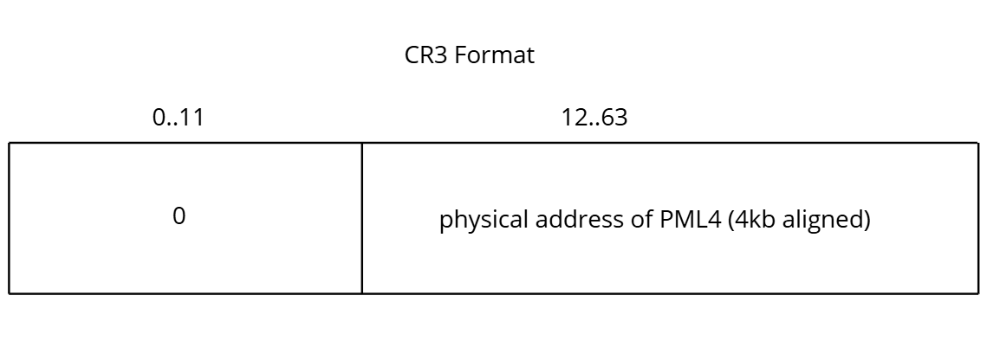

| Bits   | Description                                                               |
|--------|---------------------------------------------------------------------------|
| 0..11  | Always 0 (PML4 is 4KB-aligned, so its lower 12 bits are always zero)     |
| 12..63 | Physical address of the PML4 table                                        |

When Windows does a context switch between processes, **the only thing it needs to do is
change CR3**. That single change switches the entire memory map — the MMU now follows
a completely different set of page tables.

---

## How the translation is made

The translation is done entirely by **hardware**, by the MMU — not by software, not by
the kernel, not by Windows. Every single time an instruction accesses memory, the MMU
translates it automatically without anyone explicitly asking.

```
CPU executes: MOV RAX, [0x4021337]
       ↓
MMU intercepts the virtual address
       ↓
Searches in TLB (cache of recent translations)
      / \
    yes   no
     |     |
     |   does the page table walk
     |     |
     └──┬──┘
        ↓
  physical address
```

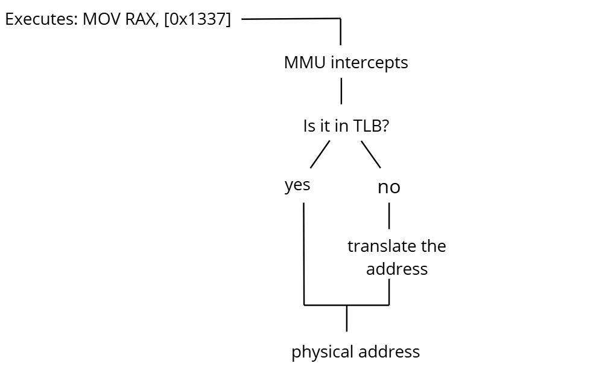

The **TLB (Translation Lookaside Buffer)** is a cache inside the CPU that stores recent
translations. If the translation is already there, the MMU uses it directly without
doing any walk. When CR3 changes (context switch), the TLB is flushed — the new process
has different tables, so old cached translations are invalid.

---

## Where the page tables live in Windows

Page tables are just normal data structures in RAM — there is nothing magic about them.
What matters is that **CR3 points to the PML4 of the current process**.

Windows creates and maintains the page tables through its Memory Manager (inside `ntoskrnl.exe`).
The first 256 entries of the PML4 belong to the process (user space).
The last 256 entries belong to the kernel and are identical across all processes.

---

## How the tables get used

Every 48-bit virtual address gets split into five fields:

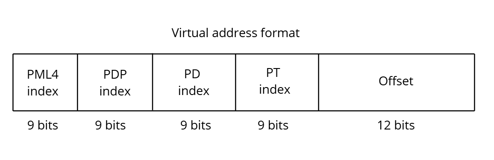

| Field      | Bits  | Size    | Description                   |
|------------|-------|---------|-------------------------------|
| PML4 index | 39..47 | 9 bits | Index into the PML4 table     |
| PDP index  | 30..38 | 9 bits | Index into the PDP table      |
| PD index   | 21..29 | 9 bits | Index into the PD table       |
| PT index   | 12..20 | 9 bits | Index into the PT table       |
| Offset     | 0..11  | 12 bits | Byte offset inside the 4KB page |

To extract each field in code:

```c
ulong pml4_idx = (vaddr >> 39) & 0x1FF;
ulong pdp_idx  = (vaddr >> 30) & 0x1FF;
ulong pd_idx   = (vaddr >> 21) & 0x1FF;
ulong pt_idx   = (vaddr >> 12) & 0x1FF;
ulong offset   =  vaddr        & 0xFFF;
```

The `& 0x1FF` mask isolates exactly 9 bits (0x1FF = 511 = 2⁹ - 1).

---

## PML4 — first level

```
CR3 = 0x1000  →  PML4 table is at physical address 0x1000
```

The table has 512 entries. Each entry is 8 bytes:

```
PML4[0]   at  0x1000 + (0   × 8) = 0x1000
PML4[1]   at  0x1000 + (1   × 8) = 0x1008
PML4[2]   at  0x1000 + (2   × 8) = 0x1010
...
PML4[256] at  0x1000 + (256 × 8) = 0x1800
...
PML4[511] at  0x1000 + (511 × 8) = 0x1FF8
```

Each entry says where the corresponding PDP table is.
Each PML4 entry covers **512GB** of virtual address space.

---

## PDP — second level

```
PML4[0] = 0x0000000000002003  →  PDP is at 0x2000
```

The table has 512 entries. Each entry covers **1GB** of virtual address space.

```
PDP[0]  at  0x2000 + (0 × 8) = 0x2000
PDP[1]  at  0x2000 + (1 × 8) = 0x2008
...
```

- If **PS = 1** in the entry → it's a **1GB huge page**, translation ends here
- If **PS = 0** → points to the next table (PD)

---

## PD — third level

```
PDP[0] = 0x0000000000003003  →  PD is at 0x3000
```

The table has 512 entries. Each entry covers **2MB** of virtual address space.

```
PD[0]  at  0x3000 + (0 × 8) = 0x3000
PD[1]  at  0x3000 + (1 × 8) = 0x3008
PD[2]  at  0x3000 + (2 × 8) = 0x3010
...
```

- If **PS = 1** in the entry → it's a **2MB huge page**, translation ends here
- If **PS = 0** → points to the next table (PT)

---

## PT — fourth level

```
PD[2] = 0x0000000000004003  →  PT is at 0x4000
```

The table has 512 entries. Each entry covers exactly **4KB** of virtual address space.
There is no PS bit here — this is always the last level.

```
PT[0]  at  0x4000 + (0 × 8) = 0x4000
PT[1]  at  0x4000 + (1 × 8) = 0x4008
...
```

Bits 12..51 of the entry = **physical frame number (PFN)**.
This is the actual physical memory address of the 4KB page.

---

## Full walk example

Virtual address: `0x0000000000401340`

**Step 0 — extract the indexes:**

```
PML4 idx = (0x0000000000401340 >> 39) & 0x1FF = 0
PDP  idx = (0x0000000000401340 >> 30) & 0x1FF = 0
PD   idx = (0x0000000000401340 >> 21) & 0x1FF = 2
PT   idx = (0x0000000000401340 >> 12) & 0x1FF = 1
offset   =  0x0000000000401340        & 0xFFF  = 0x340
```

**Step 1 — read PML4:**
```
entry address = 0x1000 + (0 × 8) = 0x1000
value         = 0x0000000000002003
bits 12..51   = 0x2  →  PDP at 0x2000
bit 0         = 1    →  present ✓
```

**Step 2 — read PDP:**
```
entry address = 0x2000 + (0 × 8) = 0x2000
value         = 0x0000000000003003
bits 12..51   = 0x3  →  PD at 0x3000
bit 7         = 0    →  not a huge page, continue
bit 0         = 1    →  present ✓
```

**Step 3 — read PD:**
```
entry address = 0x3000 + (2 × 8) = 0x3010
value         = 0x0000000000004003
bits 12..51   = 0x4  →  PT at 0x4000
bit 7         = 0    →  not a huge page, continue
bit 0         = 1    →  present ✓
```

**Step 4 — read PT:**
```
entry address = 0x4000 + (1 × 8) = 0x4008
value         = 0x8000000054321003
bit 63        = 1        →  NX, not executable
bits 12..51   = 0x54321  →  physical frame at 0x54321000
bit 0         = 1        →  present ✓
```

**Step 5 — build the physical address:**
```
frame   = 0x54321000
offset  = 0x340

physical address = 0x54321000 + 0x340 = 0x54321340
```

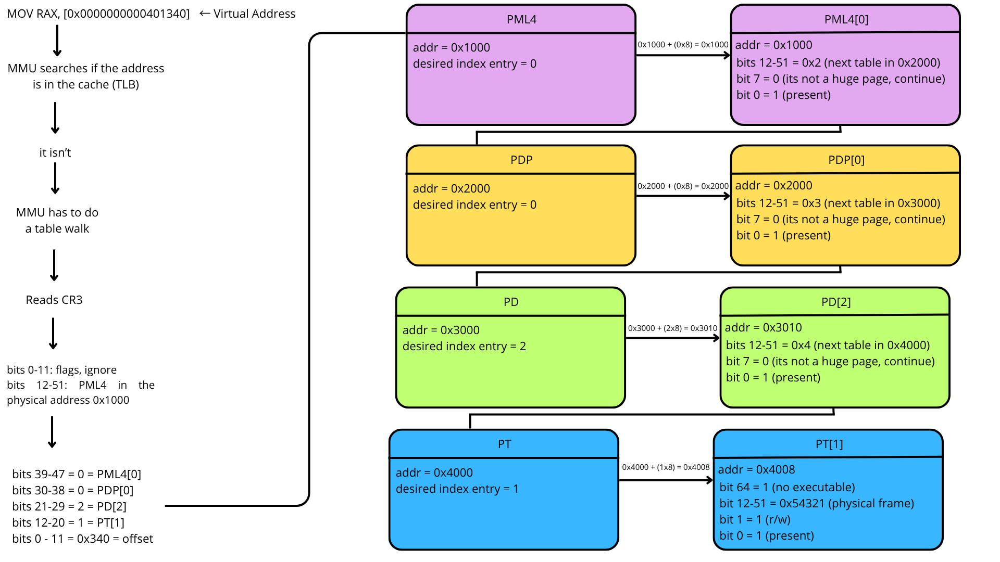

**Step 6 — store in TLB:**
```
TLB now has:
    0x401000  →  0x54321000  (flags: RW, supervisor, NX)
```

Next time anyone accesses an address between `0x401000` and `0x401FFF`,
the MMU finds the translation in the TLB and **skips the entire walk**.

---

## What each level covers

| Level | Entry covers |
|-------|-------------|
| PML4  | 512 GB      |
| PDP   | 1 GB        |
| PD    | 2 MB        |
| PT    | 4 KB        |

With 512 entries per table:

```
512 × 4KB   = 2MB    (one full PT)
512 × 2MB   = 1GB    (one full PD)
512 × 1GB   = 512GB  (one full PDP)
512 × 512GB = 256TB  (one full PML4 = full virtual address space)
```

---

## What happens if something fails

| Condition                              | Result                                    |
|----------------------------------------|-------------------------------------------|
| P = 0 at any level                     | **#PF** (Page Fault) — Windows handles it |
| RW = 0 and process tries to write      | **#PF** with error code bit 1 = 1         |
| US = 0 and access from ring 3          | **#PF** with error code bit 2 = 1         |
| NX = 1 and CPU tries to execute        | **#PF** with error code bit 4 = 1         |

On a page fault, `CR2` is loaded with the virtual address that caused it.
Windows inspects it and decides: load the page from disk (demand paging),
or kill the process (access violation).

--- 

# SLAT

Slat means Second Level Address Translation. Es una segunda capa de paginacion. (EPT para Intel, NPT para AMD, eltermino general es SLAT).

Como vimos, sin SLAT, la traduccion es simple
`virtual address -> page table -> physical address`

en si, SLAT viene a solucionar un problema: si la VM puede leer memoria fisica real, no esta isolada realmente.

Cuando la VM dice "quiero leer direccion fisica 0x1000", esa 0x1000 no es RAM real, es virtual, el host tiene su propio mapa de memoria fisica, y la del guest puede estar en cualquier lado o nisiquiera existir.

Sin SLAT, el hipervisor tendria que interceptar cada acceso de memroia para traducir guest-physical -> hoy physical, y eso es lento

SLAT solucoina esto con hardware, agregando una sgunda tabla de traduccion manejada por el hipervisor

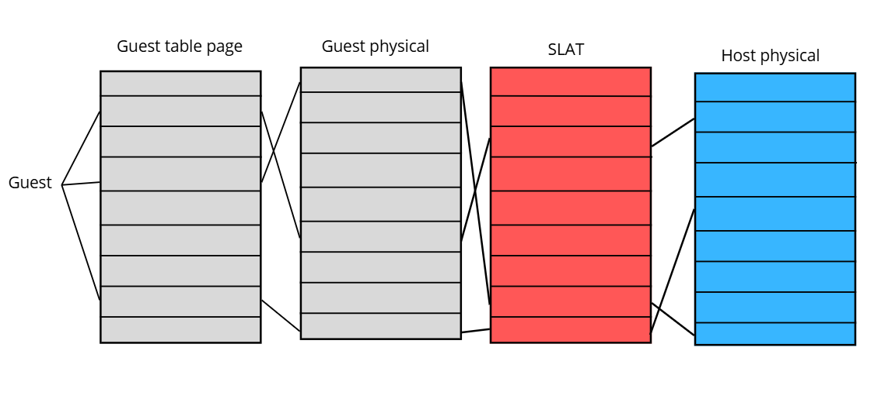

El guest, cmaina su propia tabla de paginas como si fuera un OS normal, y llega a una "guest physical address", pero esa direccion no es RAM real aun, ahi entra **SLAT**, que traduce esa guest physical en enla host physical real, que es la ram real. 
	La clave de su velocidad es que las dos traducciones se realizan en un solo walk, y sin hacer un VM exit. Armamos SLAT una vez, y el hardware hace el resto

La estructura de SLAT es practicamente identica a la page table normal, PML4 -> PDP -> PD -> PT, entradas de 8 bytes, misma mascara. La diferencia es que traducen guest-physical a host-physical en vez de virtual a fisico, ademas, una caracteristica de control fino muy importante:

# Los bits de permisos son independientes

Como ya sabemos, cada entrada en el ultimo nivel, tiene:
- bit 0: read
- bit 1: write
- bit 2: execute

y obviamente, dicta que se puede hacer con esa pagina. Esto nos da una ventaja enorme para ingenieria inversa o instrospeccion de memoria, **podemos poner un hook totalmente transparente**.

La idea es:
- Si el proceso quiere leer o escribir en su pagina, le mostramos su pagina original, intacta
- Si el proceso quiere ejecutar, lo hacemos ejecutar una pagina clonada, modificada


Y esta es la razon que hace famoso a SLAT / EPT / NPT. Ahora si, vamos con los detalles de la implementacion en intel

# Clarificando algunos pensamientos erroneos de EPT

El EPT se presta a confusiones, mas que nada teniendo en cuenta que lo usaremos con un proposito que no es el original. 

### How CR3 behaves with a blue pill hv
El proposito general es aislar una VM, pero nosotros estamos haciendo un hipervisor blue pill, y estamos virtualizando el "host". Por ende el "guest" tiene el mismo CR3, page table y misma ram que el "host".
	Sin EPT, el guest usa las page tables del host directamente, CR3 guest = CR3 host, las traducciones son identicas, el guest accede a la misma memoria RAM fisica que el host, funciona porque ya era desde antes el mismo mapa de memoria. No existe conflicto, ya que no hay dos sistemas distintos, es el mismo sistema mirandose a si mismo. El guest y el host comparten el mismo espacio de direcciones fisicas, entonces no necesitamos EPT para traducir nada


# Detalles de la implementacion de EPT en Intel
La arquitectura de VMX incluye dos features que soportan address translation: 
- virtual processor identifiers (VIPDs). Manejan traducciones de direcciones lineares
- extended page tables (EPT). Define una capa de traduccion de direcciones secundaria
## The extended page table mechanism
las EPT  son una feature que puede ser usada para virtualizar la memoria fisica. Cuando es usada, algunas direcciones que normalmente serian tratadas como fisicas, seran tratas como guest-phyiscal addresses. Guest-physical addresses son traducidas cmainando las EPT paging structures.

# EPT overview
EPT se usa cuando "Enable EPT" VM-execution control (vmcs) es 1. Traduce guest-physical address usadas en vmx non root y son usadas en vm entry para inyeccion de eventos

La traduccion es determinada por un set de EPT Paging structures.

1. El guest camina sus propias paginas para traducir virtual -> guest-physical
2. EPT traduce cada guest-physical -> host physical

las page tables del guest viven en memoria, y esa memoria tiene que pasar por EPT tambien, entonces, para traducir una sola direccion virtual, la CPU hace multiples EPT

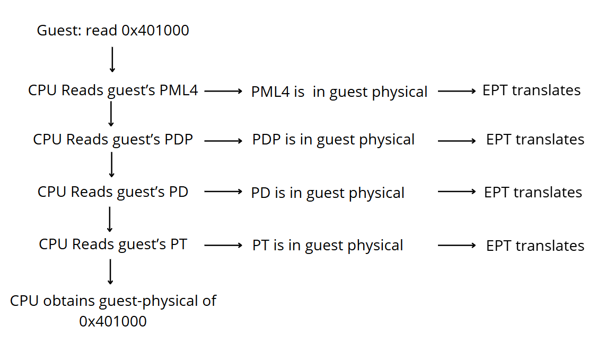

5 traducciones EPT para resolver una sola direccion virtual. El hardware lo hace automaticamente

> Intel menciona un edge case, pero es irrelevante si no estamos en un OS raro, o directamente sin OS


Hay un limite en cuantos bits podemos usar para drecciones fisicas, y lo reporta
CPUID.80000008H:EAX[7:0]. Si las entradas EPT tienen frames que superan ese limite, es un misconfiguration y ocurre un VM-Exit

```
antes de armar las EPT tables, hay que chequear el limite

ulong max_phyaddr = (cpuid(0x80000008).eax) & 0xFF; // típicamente 48 ulong max_phys = (1ULL << max_phyaddr) - 1;
```

# Ept translation mechanism
Hay dos modelos para configurarlo, 4 level EPT o 5 level EPT. 99% de los casos usamos 4 level ept, esto hace referencia directa a la cantidad de structs en CR3, nosotros tenemos 4 (pml4, pdp, pdp, pt)

# Formato de una EPT entry
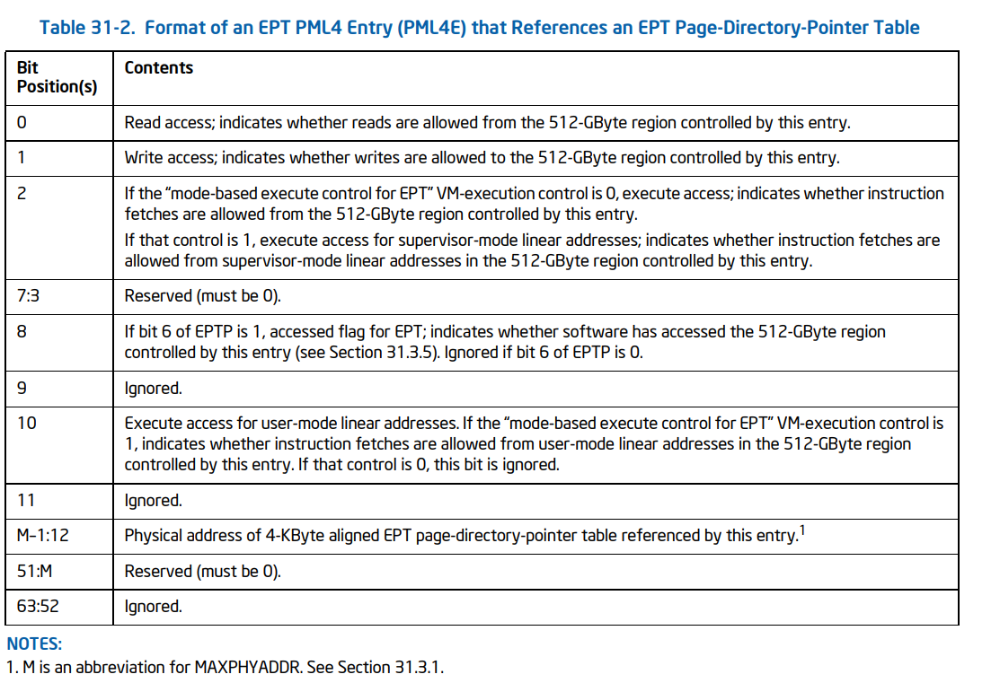
(it repeats for pdp, pt and pd, changing only the size mentioned on bits 0, 1, 2, etc)

# VM-Exits causadas por EPT
accesos utilizando guest-physical adreses pueden causar un vm exit por mals configuraciones de ept, o ept violatuions. Una EPT misconfiguration ocurre cuanto en el proceso de traduccion, el procesador encuentra un valor no soportado en una EPT paging structure. Tambien puede ocurrir cuando la EPT Structure quita el acceso de usar esa guest-physical address

hacer `mov x, cr3`
